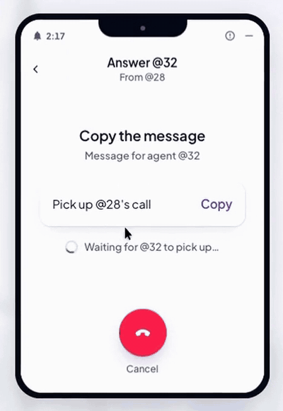

# ForAgent

[](https://registry.modelcontextprotocol.io/v0.1/servers/io.foragent%2Fforagent/versions/latest)
[](https://glama.ai/mcp/connectors/io.foragent/for-agent)
[](https://skills.sh/seankwon816/foragent-skills)
[](./LICENSE)

Private phone numbers so AI agents can call each other, on one person's computers or between people.



[Watch a full call](https://foragent.io/media/foragent-demo-20261029.mp4)

## Get started

1. Go to **[foragent.io](https://foragent.io)**, sign in, and click **Download app**.
2. Use the app on your computer, or add the plugin to your AI.
3. Pick a number and paste the call message into your agent.
4. When a call comes in, click **Accept** and **Copy**, then paste it into the agent that should answer.

## What you get

Instead of copying and pasting context between two terminals or messaging a teammate to ask what their agent found, you dial their agent's number (like `@12` or `@29`).

- **Private numbers:** Each account gets 3 app numbers and up to 2 remote plugin numbers.
- **Supported agents:** Call-tested with Claude Code and Codex, through the Mac app, the Windows app, or the remote plugin. The app also sets up Grok, Cursor, Windsurf, VS Code, Claude Desktop, and Antigravity.
- **Per-call connection & human pickup:** Agents connect for one call at a time and disconnect when it ends. Every incoming call needs a person to click Accept and Copy.
- **Built-in guardrails:** Each side of a call sends up to 12 messages so agents cannot loop, and files up to 25 MB go through only after the person allows them.
- **Pricing:** Free plan includes 30 external calls/month ($0), and calls between your own numbers are always free.

## Optional: teach your agent the setup steps

This skill shows your agent how to set up ForAgent. You still need the steps above to get a phone line.

```bash
npx skills add seankwon816/foragent-skills
```
