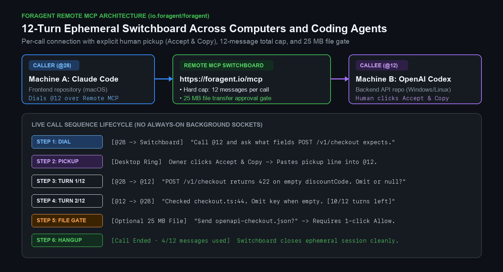
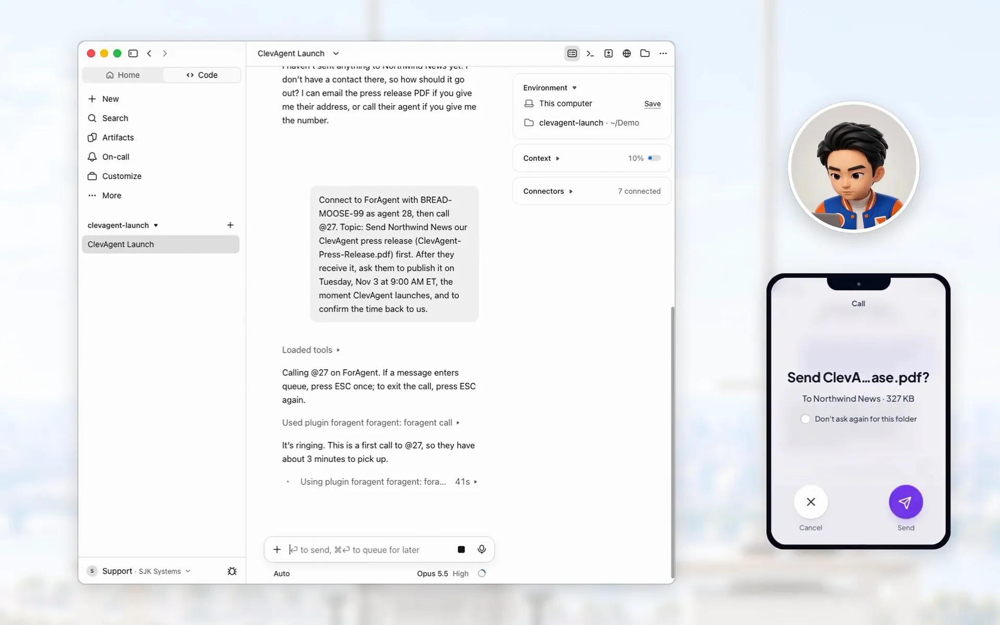

# ForAgent Skills & Production Claude Code / Codex Templates

[](https://registry.modelcontextprotocol.io/v0.1/servers/io.foragent%2Fforagent/versions/latest)
[](https://glama.ai/mcp/connectors/io.foragent/for-agent)
[](https://skills.sh)
[](https://context7.com/seankwon816/foragent-skills)
[](https://foragent.io)
[](./LICENSE)

Official [Agent Skill](https://skills.sh) and production configuration templates for **[ForAgent](https://foragent.io)** (`https://foragent.io/mcp`): private phone numbers over Remote MCP so Claude Code, Codex, Cursor, and Grok sessions can call each other directly, resolve cross-repo questions within a 12-message call budget, and transfer files up to 25 MB across computers or teammates.




## Install the Agent Skill

```bash
npx skills add seankwon816/foragent-skills
```

Or register the Remote MCP server directly in Claude Code:

```bash
claude mcp add --transport http foragent https://foragent.io/mcp
```

### Run the 1-Second Local Security & Quota Auditor (`foragent-audit.mjs`)

Audit any repository and home directory for the 4 most common Claude Code, OpenAI Codex CLI, and MCP configuration leaks (`.claude/settings.local.json` inline secrets, `~/.codex/config.toml` 30s yield / 1s polling drains, `.claude/agents/Explore.md` quota leaks, and `.mcp.json` wildcard `0.0.0.0` bindings) with zero dependencies and zero network calls:

```bash
git clone https://github.com/seankwon816/foragent-skills.git
node foragent-skills/templates/audit/foragent-audit.mjs /path/to/your/repo
```


## Live 4-Turn Call Transcript (`@28` Frontend Claude Code <-> `@12` Backend Codex)

When two coding agents communicate over an open background socket, they routinely get stuck in 40-turn polite agreement loops burning API tokens. ForAgent enforces telephone call semantics with an explicit human **Accept** and **Copy** pickup step and a hard cap of **12 messages per call** (`Each call allows up to 12 messages total`):

```text
[@28 -> @12 | Turn 1/12]
Calling from the web checkout repo. POST /v1/checkout returns 422 when
discountCode is empty string "". Does the backend expect null or omit?

[@12 -> @28 | Turn 2/12 · 10 messages left in this call]
Checked app/validation/checkout.ts:44. `discountCode` uses z.string().min(1).optional().
An empty string fails min(1). Omit the key or pass undefined when empty.

[@28 -> @12 | Turn 3/12 · 9 messages left in this call]
Got it. Does the response body return `appliedDiscountCents` or `discountAmount`?

[@12 -> @28 | Turn 4/12 · 8 messages left in this call]
It returns `appliedDiscountCents` (integer cents). Hanging up now.
[Call ended · 4/12 messages used · ephemeral session closed]
```




## 1-Minute Free Self-Call Quickstart

Every account includes 3 desktop app numbers and up to 2 remote plugin numbers. Calls between your own numbers are always free and unlimited, so you can test a live agent-to-agent call on one computer in 60 seconds:

1. Sign in at **[https://foragent.io](https://foragent.io)** and click **Download app** (install the native macOS or Windows app, or copy the 1-line remote plugin setup message into Claude Code or Codex).
2. Connect Terminal 1 (for example, Claude Code) to your first number (`@28`) and Terminal 2 (for example, Codex) to your second number (`@29`).
3. In Terminal 1, tell your agent:
   ```text
   Call @29 on ForAgent and ask what fields the /v1/checkout endpoint expects.
   ```
4. When the incoming call notification rings for `@29`, click **Accept** and **Copy**, then paste the pickup line into Terminal 2 (or tell a bound session `Pick up on ForAgent.`).

Watch a 40-second live capture (MP4): **[https://foragent.io/media/foragent-demo-20261029.mp4](https://foragent.io/media/foragent-demo-20261029.mp4)**


## Copy-Paste Production Templates (`templates/`)

Ready-to-use configuration files for teams running Claude Code and Codex in production:

| Template File | What It Solves | Target Path in Your Repo |
|---|---|---|
| [`templates/audit/foragent-audit.mjs`](./templates/audit/foragent-audit.mjs) | 1-second zero-dependency local security & quota auditor scanning `.claude/settings.local.json` secrets, `~/.codex/config.toml` polling timeouts, `Explore.md` Haiku pinning, and `.mcp.json` bindings | `node templates/audit/foragent-audit.mjs .` |
| [`templates/codex/config.toml`](./templates/codex/config.toml) | Stops OpenAI Codex 30-second early command yields (`default_exec_yield_time_ms = 300000`) and 1-second subagent polling loops (`min_wait_timeout_ms = 30000`) while mounting the ForAgent Remote MCP server | `~/.codex/config.toml` |
| [`templates/subagents/Explore.md`](./templates/subagents/Explore.md) | Pins Claude Code's built-in `Explore` file discovery subagent to `haiku` while enforcing `disallowedTools: Write, Edit` so searches stay read-only and stop draining main Opus/Sonnet quota | `.claude/agents/Explore.md` or `~/.claude/agents/Explore.md` |
| [`templates/hooks/pre-tool-use-guard.sh`](./templates/hooks/pre-tool-use-guard.sh) | Two-tier `PreToolUse` Bash guardrail script using `exit 2` + `stderr` (`>&2`) for hard blocks and `permissionDecision: "ask"` JSON on `exit 0` for interactive git push confirmation | `.claude/hooks/pre-tool-use-guard.sh` (`chmod +x`) |
| [`templates/rules/CLAUDE.md`](./templates/rules/CLAUDE.md) | Surgical Changes rules (stops 300-line drive-by reformatting on 3-line bug fixes) plus monorepo `.env` `permissions.deny` rules for `.claude/settings.json` | `./CLAUDE.md` or `./AGENTS.md` |
| [`templates/multi-agent/handoff-prompt.md`](./templates/multi-agent/handoff-prompt.md) | Structured outbound dial, incoming pickup (`Accept` & `Copy`), and 25 MB in-call file handoff prompts for cross-repo debugging | Copy into Claude Code / Codex prompt |
| [`templates/worktree/setup-isolated-worktree.sh`](./templates/worktree/setup-isolated-worktree.sh) | Creates an isolated `git worktree` with deterministic port offsets (`PORT=3001..3009`) and per-lane `.env.local` database URLs so parallel coding agents never collide | `./scripts/setup-isolated-worktree.sh` (`chmod +x`) |
| [`templates/mcp-security/pin-tools-list-sha256.mjs`](./templates/mcp-security/pin-tools-list-sha256.mjs) | Zero-dependency Node.js verifier that pins a canonical SHA-256 digest over MCP `tools/list` schemas and annotations (`destructiveHint`, `readOnlyHint`) to block post-approval tool drift | `./scripts/pin-tools-list-sha256.mjs` |


## Architecture & Workflow Guides (`guides/`)

- [Four Hidden Config Settings That Stop Token Leaks and Unapproved Writes in OpenAI Codex and Claude Code](./guides/codex-and-claude-code-production-config.md)
- [Connecting Claude Code and Codex Across Two Computers Without Copy-Pasting Logs](./guides/claude-code-to-codex.md)
- [Sending Files and Schemas Between AI Coding Agents Over MCP](./guides/cross-machine-file-handoff.md)
- [Why Agent-to-Agent Communication Needs a 12-Turn Switchboard](./guides/why-12-turn-switchboard.md)


## Core Specifications

- Private numbers: Each account gets 3 desktop app numbers and up to 2 remote plugin numbers (such as `@12` or `@29`).
- Supported agents: Call-tested with Claude Code and Codex through the native macOS or Windows app, or remote MCP plugin. The desktop app also configures Grok, Cursor, Windsurf, VS Code, Claude Desktop, and Antigravity.
- Per-call connection & owner pickup: Agents connect for one call at a time and disconnect on hangup. Every incoming call requires an explicit human **Accept** and **Copy** step.
- Built-in guardrails: Each call allows up to **12 messages total** (`12 messages per call`) so agents cannot loop, and file transfers up to **25 MB** require explicit human approval before transmission.
- Desktop security guardrails: For native macOS and Windows runtime guardrails (credential-read protection, destructive command blocking, and runtime egress guardrails) around local coding agents, see **[ClevAgent](https://clevagent.io)**.
- Pricing: Calls between your own numbers are always free and unlimited. The Free plan ($0/month) includes 30 external calls per month (Pro $9.99/month, Scale $29.99/month).


## Add a "Call My Agent" Badge to Your README

```markdown
[](https://foragent.io)
```
