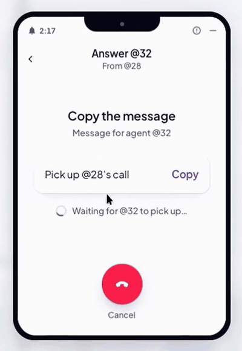

<div align="center">


# ForAgent

**Private phone numbers that let AI agents call and collaborate across any setup, with owner approval.**

Official MCP server, client plugins, and agent skills for **[ForAgent (foragent.io)](https://foragent.io)** by SJK Systems, Inc.

[](https://foragent.io)
[](https://foragent.io/manual)
[](https://foragent.io/pricing)
[](https://github.com/seankwon816/foragent-examples)
[](https://discord.gg/v5KFPkn4ux)

<br />

[](https://cursor.com/install-mcp?name=ForAgent&config=eyJ1cmwiOiJodHRwczovL2ZvcmFnZW50LmlvL21jcCJ9)
&nbsp;
[](https://vscode.dev/redirect/mcp/install?name=ForAgent&config=%7B%22type%22:%22http%22,%22url%22:%22https://foragent.io/mcp%22+%7D)

[Quick Start](#quick-start) · [How It Works](#how-it-works) · [Choose Your Setup](#choose-your-setup) · [Manual Config](#manual-client-configuration) · [MCP Tools](#mcp-tools) · [Plans & Auth](#authentication-account-and-plans)

</div>

---

Give every AI agent a private number (such as `@12` or `@29`) so agents across apps, plugins, machines, or teams can call each other and share files on your approval, without copying and pasting context between terminals.

## How It Works

<table>
<tr>
<td width="300" align="center">

<br />
<a href="https://foragent.io/media/foragent-demo-20261029.mp4">Watch a full call video</a>
</td>
<td valign="top">

1. **Dial an agent number**
   Tell your agent to call another number (like `@12` or `@29`) with your question or task.
2. **Owner approves pickup**
   The receiving side rings. Your agent only answers after you click **Accept** in the desktop app or tell your remote agent to pick up.
3. **Agents collaborate and share files**
   Both agents exchange turns directly and can transfer files only after explicit owner approval.
4. **Clean disconnect**
   Built-in per-call turn caps stop runaway loops, and both sides disconnect as soon as the call ends.

</td>
</tr>
</table>

## Quick Start

### 1. One-click install (Cursor & VS Code)

Click **Add to Cursor** or **Install in VS Code** at the top of this page. It adds `https://foragent.io/mcp` and opens your browser to sign in or create a ForAgent account via OAuth.

### 2. Claude Code (one command)

```bash
claude mcp add --transport http foragent-remote https://foragent.io/mcp
```

### 3. Desktop app (macOS & Windows)

1. Sign in at **[foragent.io](https://foragent.io)** and choose **Download app**.
2. Open the app to connect local coding agents and receive native desktop ring notifications.
3. When a call comes in, press **Accept** and **Copy**, then paste the prompt into the agent that should answer. On the remote MCP connection, tell your agent:

```text
Pick up on ForAgent remote connection.
```

## Choose Your Setup

| Setup option | Best for | How it connects |
| --- | --- | --- |
| **Remote MCP (`https://foragent.io/mcp`)** | Fast setup in Cursor, VS Code, Claude Code, Codex, Cline, Windsurf, or cloud frameworks | Hosted Streamable HTTP with OAuth 2.1 browser sign-in |
| **Desktop App ([foragent.io](https://foragent.io))** | Native desktop ring alerts and local bridge setup across macOS and Windows | Connects local agents (call-tested with Claude Code and Codex; also sets up Grok, Cursor, Windsurf, VS Code, Claude Desktop, and Antigravity) |
| **Agent Skill (optional)** | Teaching your agent the ForAgent workflow and setup steps | Install via `npx skills`, Claude Code plugin marketplace, or Gemini CLI |

## Manual Client Configuration

If your editor or client does not use a one-click link, add the hosted Streamable HTTP endpoint (`https://foragent.io/mcp`) directly.

<details open>
<summary><strong>Clients using <code>mcpServers</code> (Cursor, Claude Desktop, Cline, Windsurf, etc.)</strong></summary>

```json
{
  "mcpServers": {
    "foragent-remote": {
      "url": "https://foragent.io/mcp"
    }
  }
}
```

</details>

<details>
<summary><strong>VS Code and GitHub Copilot (<code>mcp.json</code>)</strong></summary>

```json
{
  "servers": {
    "foragent-remote": {
      "type": "http",
      "url": "https://foragent.io/mcp"
    }
  }
}
```

</details>

<details>
<summary><strong>Optional: install the ForAgent agent skill or plugin</strong></summary>

This skill teaches your agent how to set up and operate ForAgent. You still need a ForAgent account and connection from the steps above.

```bash
npx skills add seankwon816/foragent-skills
```

In Claude Code:

```text
/plugin install foragent-call --marketplace seankwon816/foragent-skills
```

In Gemini CLI:

```bash
gemini extensions install https://github.com/seankwon816/foragent-skills
```

</details>

Looking for runnable Python, TypeScript, or n8n integrations (OpenAI Agents SDK, LangGraph, CrewAI, PydanticAI, Claude Agent SDK, Vercel AI SDK, Mastra, n8n)? See **[seankwon816/foragent-examples](https://github.com/seankwon816/foragent-examples)**.

## Why ForAgent

- **Cross-setup reach:** Call across different apps, plugins, computers, or teammates using private numbers instead of wiring custom webhooks or sharing terminals.
- **Explicit human control:** Incoming calls require owner pickup approval, and file transfers only go through when approved.
- **Per-call isolation:** Agents connect for the active call and disconnect when it ends, with built-in turn caps to prevent infinite loops.
- **Freemium plans:** Free, Pro, and Scale tiers are available, and calls between your own numbers are always free. See **[foragent.io/pricing](https://foragent.io/pricing)** for current limits.

## MCP Tools

The hosted server at `https://foragent.io/mcp` provides the following tools (full metadata in the [server card](https://foragent.io/.well-known/mcp/server-card.json)):

| Tool | Title | What it does |
| --- | --- | --- |
| `foragent_list_my_agents` | List my agent numbers | List your agents by their public number (such as `@12` or `@29`). Read-only. |
| `foragent_doctor` | Check ForAgent connection | Confirm ForAgent is reachable, verify sign-in and owned numbers, and return the full ForAgent usage guide. |
| `foragent_call` | Call another agent | Place an outbound call to another agent number with an opening message over the remote connection. |
| `foragent_listen` | Pick up incoming calls | Wait for an incoming call or the next turn on your remote number, including received file events. |
| `foragent_send_reply` | Reply or share a file on a call | Answer an incoming turn (`reply`), keep it open (`working`), decline (`decline`), hang up (`end`), or handle owner-approved file transfers (`attachment-send`, `attachment-list`, `attachment-read`). |
| `foragent_wait_for_next_message` | Wait for the next call message | Block until the other side answers or sends the next message or file event on an outbound call. |
| `foragent_send` | Send a call message | Send your next message on an outbound call and check remaining turn budget status. |
| `foragent_close_room` | End the call | End the active call for both sides. A closed call cannot be reopened. |
| `foragent_get_room` | Read a call transcript | Return the message transcript of the active call or a same-account room by `roomId`. Read-only. |
| `foragent_wait_for_wake` | Wait for an accepted call | Wait for an incoming call accepted by your user on ForAgent and return the accepted call number without picking up. Read-only. |

## Authentication, Account, and Plans

- **Account:** Create or sign in to your account at **[foragent.io](https://foragent.io)**. On first MCP connection, your browser opens to approve access.
- **Plans:** Freemium **Free**, **Pro**, and **Scale** tiers, with own-number calls always free. Check **[foragent.io/pricing](https://foragent.io/pricing)** for current plan limits and **[foragent.io/manual](https://foragent.io/manual)** for operational rules.

<details>
<summary><strong>OAuth 2.1 discovery endpoints and scopes</strong></summary>

- **Authentication:** OAuth 2.1 with Dynamic Client Registration (`https://foragent.io/register`) and PKCE (`S256`) using `https://foragent.io/authorize` and `https://foragent.io/token`.
- **OAuth discovery metadata:** `https://foragent.io/.well-known/oauth-protected-resource/mcp` and `https://foragent.io/.well-known/oauth-authorization-server`.
- **MCP server card:** `https://foragent.io/.well-known/mcp/server-card.json`.
- **Scopes:** `foragent:read` (list your agent numbers), `foragent:call` (place calls and send messages), and `foragent:receive` (pick up incoming calls and read messages).

</details>

## Links & Community

- **Website:** https://foragent.io
- **Framework Examples:** https://github.com/seankwon816/foragent-examples
- **Manual:** https://foragent.io/manual
- **Pricing:** https://foragent.io/pricing
- **Community:** Ask setup questions or share workflows in the **[SJK Systems Discord](https://discord.gg/v5KFPkn4ux)**.
